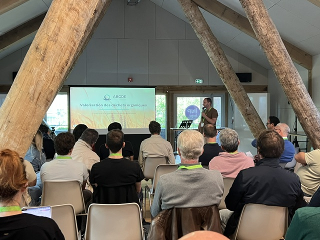

Le 6 octobre dernier, chercheurs, gestionnaires routiers, collectivités, entreprises et associations se sont réunis à l’occasion de la journée scientifique « Concevoir des filières de valorisation de la biomasse des bords de route : une perspective territoriale », organisée par la chaire SAGID+ dans le cadre du Mois de la Bioéconomie. L'événement s'est déroulé à l'ENSGSI à Nancy et a accueilli un total de 38 participants. Une question guidait la journée : comment transformer une ressource abondante, aujourd’hui traitée comme un déchet, en véritable opportunité pour les territoires ?

 Introduction de la journée par Mauricio Camargo 
  

**Expérimentations territoriales, projets industriels et recherches scientifiques**

La matinée a été consacrée à une série de conférences permettant d'aborder différents aspects de la valorisation de la biomasse des bords de route.

Les deux premières présentations ont permis de comprendre la valorisation de la biomasse du côté du gestionnaire de réseaux avec des retours d'expérience de la communauté de communes du Couesnon Marches de Bretagne (35) et le conseil départemental de Seine Maritime représentés respectivement par Henri-Pierre Rouault et Annabelle Marais. Ces deux premières interventions ont permis de mettre en lumière les bénéfices que le fauchage avec exportation peuvent générer sur un territoire mais aussi les contraintes liées à sa mise en place.

 Retour d'expérience du CD76 par Annabelle Marais 
  
 

Ensuite, les travaux scientifiques engagés dans la chaire SAGID+ ont été exposés par Lorena Espinoza et Ignacio Castaneda qui ont eu l'occasion de présenter l'avancée de leurs travaux de thèse.

La matinée s'est achevée par deux présentations d'entreprise de valorisation des déchets. Loïc Delettre nous a présenté l'expertise de l'entreprise ABCDE axée autour de la séparation des différents types de matières dans le but de valoriser des déchets organiques de différentes sources allant des restes alimentaires aux sables de voiries. Christian Roggeman a clôturé la session en présentant le concept de l'entreprise Gramitherm qui valorise l'herbe issue d'espaces non cultivés pour en faire des panneaux d'isolation.

 Loïc Delettre présente l'entrepise ABCDE 
  

**Des retours d’expérience européens**

L'après-midi a débuté par un regard sur ce qui se fait ailleurs. VITO a présenté le projet Grassification (Interreg 2 Mers, 2018-2021), qui a réuni 14 partenaires de Belgique, des Pays-Bas et du Royaume-Uni autour de la collecte de l’herbe de bords de route et de sa valorisation industrielle : biogaz, biocomposites en fibres d’herbe, engrais et protéines.

L’Université de Lorraine (DI-PRO) a ensuite replacé le sujet dans le cadre des stratégies européennes : bioéconomie, directive-cadre sur les déchets, règlement fertilisants, Biotech Act II à venir. Un point clé : la biomasse des bords de route reste considérée comme un déchet à valoriser plutôt que comme un sous-produit, ce qui conditionne ses débouchés.

**Cinq pistes de projets issues de l’atelier**

L’atelier de co-construction a fait émerger cinq propositions complémentaires : 
- caractériser la biomasse pour viser des valorisations à plus forte valeur ajoutée,
- sécuriser la filière par un cahier des charges partagé, 
- aider la décision territoriale par des scénarios, 
- dépolluer et valoriser les boues de fossés, 
- optimiser la logistique à l’échelle d’un territoire. 

Elles ont été regroupées en six chantiers : connaissance de la ressource, débouchés et modèle économique, qualité et pollutions, logistique territoriale, cadre réglementaire, gouvernance et financement.

 Moment de partage au cours de l'atelier de co-construction 
  

**Ce que la table ronde nous a appris**
- Un langage commun est indispensable entre des acteurs issus d’univers différents, tout comme la pédagogie et le partage des connaissances.
- Les acteurs pivots, ceux qui gèrent ou mobilisent de gros flux de matière, peuvent structurer les futures filières.
- Multiplier les débouchés plutôt que chercher une voie unique, selon la ressource et le territoire.
- Sortir du cercle vicieux du financement : les investisseurs attendent des projets matures, mais la maturation exige des moyens. Les démonstrateurs et les retours d’expérience sont la clé.
- L’échelle locale est un niveau pertinent pour expérimenter et fédérer.

 Table ronde de clôture de la journée 
  

**Et maintenant ?**

L’objectif est de faire émerger un consortium capable de construire de futurs projets. Il ne s’agit pas de s’engager dans un projet déjà défini, mais d’identifier les personnes et structures désireuses de contribuer, avec leurs compétences, données, terrains ou moyens.

Vous souhaitez en être ? Contactez-nous : brunelle.marche@univ-lorraine.fr ou mauricio.camargo@univ-lorraine.fr

Cet événement a bénéficié du soutien du Programme Interdisciplinaire TRANSITION (Initiative d’Excellence Lorraine, France 2030) et de la direction des partenariats de l’Université de Lorraine.

